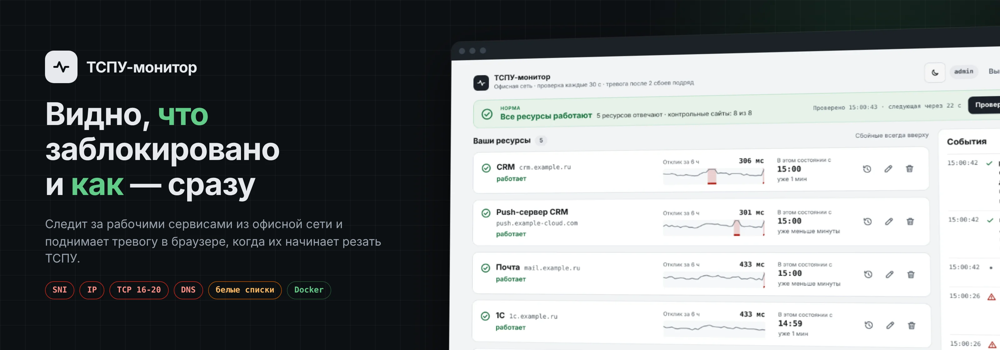
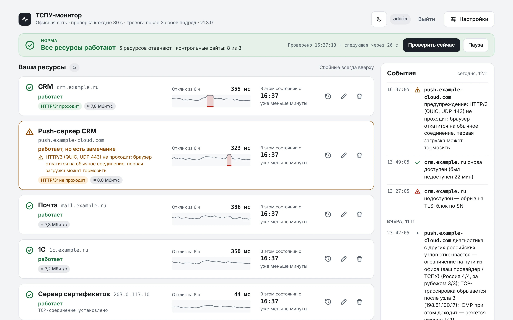
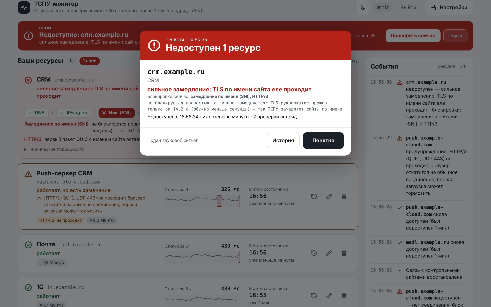
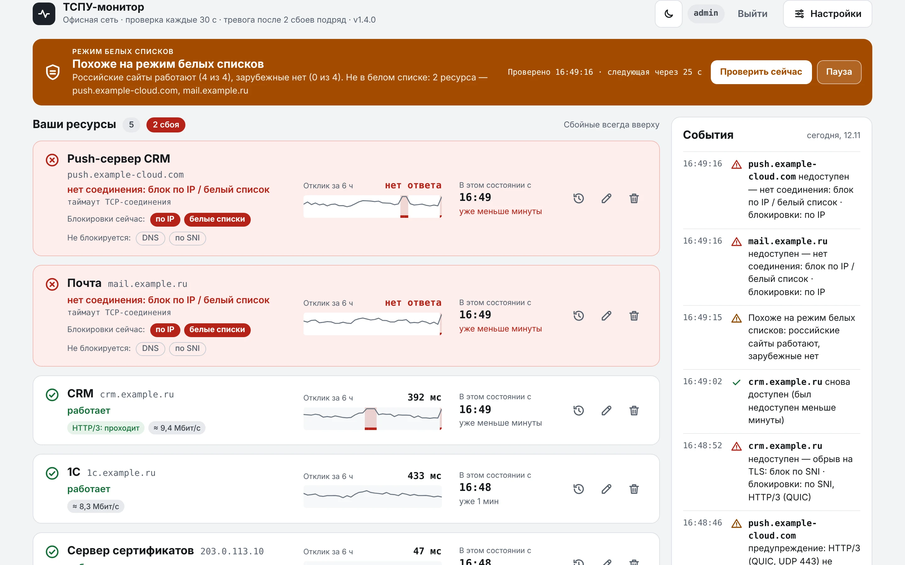
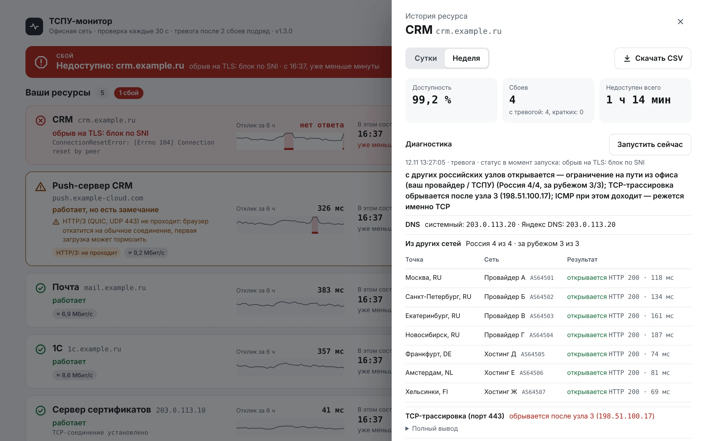
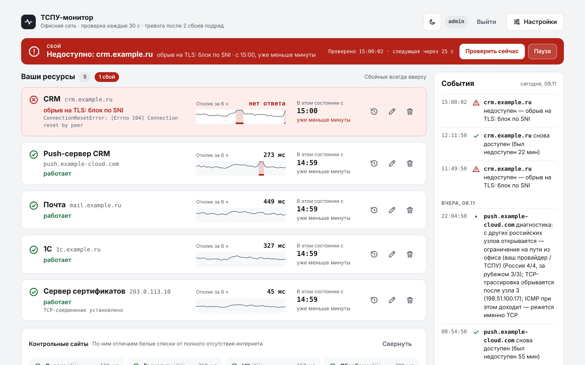
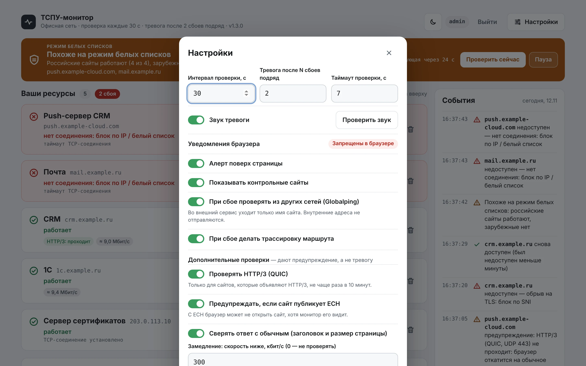
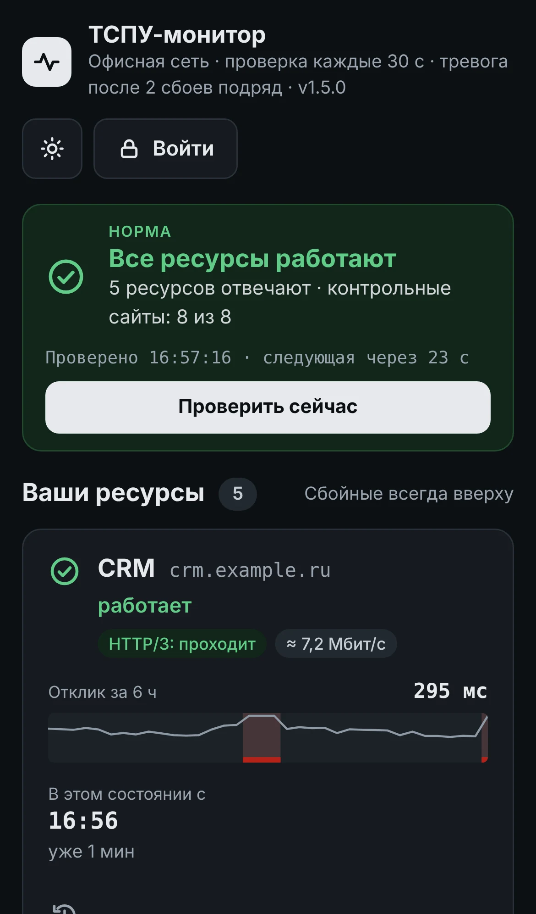

<p align="center">
  
</p>

<p align="center">
  <a href="https://github.com/vyalu/tspu-monitor/releases/latest"></a>
  
  
  
  
  
</p>

<p align="center">
  <b>Веб-сервис, который круглосуточно проверяет из офисной сети, открываются ли ваши рабочие сервисы, — и сразу говорит, как именно их режут.</b><br>
  Блокировка по SNI, по IP, белые списки, TCP 16-20, заглушки РКН, проблемы с DNS — отдельным статусом для каждого ресурса, с тревогой в браузере и историей сбоев. Плюс предупреждения о замедлении, недоступном HTTP/3 и ECH.
</p>

<p align="center">
  <a href="#-установка"></a>
</p>

<p align="center">
  
</p>

---

## ✨ Что умеет

<table>
<tr>
<td width="50%" valign="top">

### 🔍 Определяет тип блокировки
- Проверяет каждый адрес по шагам, как браузер: DNS → TCP → TLS → загрузка, и проходит по перенаправлениям до конечной страницы
- По тому, где оборвалось, ставит диагноз: **блок по SNI**, **по IP / белый список**, **TCP 16-20**, **подмена DNS**, **заглушка провайдера**
- Показывает **все блокировки сразу**: при сбое отдельно проверяет DNS, IP, имя сайта (SNI) и HTTP/3 — например, «по IP + белые списки» или «по SNI + HTTP/3»
- Замечает то, что не рвёт соединение: **замедление**, **HTTP/3 (QUIC) не проходит**, **ECH**, **ответ не похож на обычный**
- Отличает блокировку от упавшего сервера и от отсутствия интернета
- Мониторит домены, страницы с путём и голые IP-адреса с портом

</td>
<td width="50%" valign="top">

### 🛡 Видит режим белых списков
- Контрольные российские и зарубежные сайты голосуют большинством
- «Российское работает, зарубежное нет» → **режим белых списков**, и сразу видно, какие ваши ресурсы в него не попали
- «Не работает ничего» → проблема сети, а не ТСПУ
- Один заглючивший сайт вердикт не сбивает

</td>
</tr>
<tr>
<td valign="top">

### 🚨 Тревога в браузере
- Окно поверх страницы, звуковой сигнал, уведомление системы, мигающая вкладка
- Срабатывает после N сбоев подряд — без ложных тревог от случайного таймаута
- Сообщает и о восстановлении: «снова доступен, был недоступен 17 мин»
- Лента событий «сломалось / починилось» с точным временем

</td>
<td valign="top">

### 🧭 Диагностика и история
- При сбое сам проверяет ресурс **из других сетей** (Globalping), сверяет DNS и делает **трассировку** TCP и ICMP
- История за сутки и неделю: доступность в %, все сбои, включая короткие
- Выгрузка в CSV — готовое приложение к обращению провайдеру или в Роскомнадзор
- Просмотр без входа, изменения — только для администратора

</td>
</tr>
</table>

## 📸 Скриншоты

<table>
<tr>
<td width="50%"><p align="center"><sub><b>Тревога</b> — что упало, как именно и с какого времени</sub></p></td>
<td width="50%"><p align="center"><sub><b>Режим белых списков</b> — и какие ресурсы в него не попали</sub></p></td>
</tr>
<tr>
<td><p align="center"><sub><b>История и диагностика</b> — проверка из других сетей и трассировка</sub></p></td>
<td><p align="center"><sub><b>Сбой</b> — сбойные ресурсы всегда наверху, график отклика за 6 часов</sub></p></td>
</tr>
<tr>
<td><p align="center"><sub><b>Настройки</b> — интервал, порог тревоги, диагностика, пароль</sub></p></td>
<td align="center"><p align="center"><sub><b>С телефона</b> — тёмная тема и адаптивная вёрстка</sub></p></td>
</tr>
</table>

<sub>На скриншотах — демо-стенд: адреса (`*.example.ru`, `203.0.113.10`), сбои, провайдеры и узлы сети выдуманы специально для этой страницы.</sub>

## 🔎 Как читать статусы

| Статус | Что произошло |
|---|---|
| 🟢 работает | ресурс открывается полностью |
| 🔴 обрыв на TLS: блок по SNI | соединение рвётся, как только видно имя сайта |
| 🔴 нет соединения: блок по IP / белый список | до сервера не устанавливается даже TCP-соединение |
| 🔴 замирает после ~16–20 КБ: TCP 16-20 | первые килобайты приходят, потом передача замирает |
| 🔴 не резолвится DNS | имя сайта не превращается в IP-адрес |
| 🔴 адрес из вашего DNS не работает, другой работает | возможна подмена DNS или заблокированный узел CDN — подробности в диагностике |
| 🔴 подменённый сертификат | провайдер подсовывает страницу-заглушку |
| 🔴 сервер отказал в доступе (HTTP 403/451) | сайт сам не пускает: геоблокировка для российских IP или защита от ботов |
| 🔴 сервер ответил ошибкой HTTP | 404, 5xx или зацикленные перенаправления |
| 🔴 заглушка о блокировке вместо сайта | провайдер перенаправил на страницу блокировки или отдал текст «доступ ограничен… Роскомнадзор» |

Перенаправления монитор проходит, как браузер: если `example.ru` отправляет на `www.example.ru`, проверяется и конечный адрес.

### 🧩 Блокировки сейчас

Основная проверка идёт по шагам, как браузер, и останавливается на первом сбое. Но блокировок может быть несколько сразу: адрес в реестре **и** имя в списке ТСПУ, или поверх всего режим белых списков. Поэтому при сбое монитор разбирает каждый уровень отдельно и показывает на карточке, в окне тревоги и в журнале:

| Уровень | Как проверяется |
|---|---|
| DNS | системный DNS сверяется с альтернативным |
| по IP | TCP-соединение с настоящим адресом сайта |
| по SNI | имя сайта отправляется в TLS на посторонний доступный сервер (один из контрольных) и сравнивается со случайным безобидным именем. Обрыв только с именем сайта — имя в списке ТСПУ, даже если адрес тоже заблокирован |
| HTTP/3 (QUIC) | первый пакет QUIC с именем сайта, если сайт объявляет HTTP/3 |
| обрыв загрузки, заглушка / отказ | из основной проверки |
| белые списки | по голосованию контрольных сайтов |

Рядом показано, что **не** блокируется, и что проверить не удалось. Разбор повторяется не чаще раза в 2 минуты на ресурс. Это полезно для заявок на разблокировку: видно, что именно просить — адрес, имя или и то и другое.

### ⚠️ Предупреждения

Сайт открывается, но есть признаки, что в браузере у людей будут проблемы. Карточка становится жёлтой, запись попадает в журнал событий, **тревога не поднимается**. Каждое предупреждение отключается в настройках.

| Предупреждение | Что проверяется |
|---|---|
| 🟡 замедление | скорость загрузки страницы ниже порога (по умолчанию 300 кбит/с) — так ТСПУ «душит» сервисы, не блокируя их |
| 🟡 HTTP/3 (QUIC) не проходит | сайт объявляет HTTP/3, но первый пакет QUIC с именем сайта остаётся без ответа: режут UDP 443 или QUIC по SNI. Браузер откатится на обычное соединение, но первая загрузка может тормозить |
| 🟡 сайт публикует ECH | в DNS у сайта есть ключ ECH (шифрованное имя). Подключения с ECH в России режут, поэтому браузер может не открыть сайт, хотя монитор его видит |
| 🟡 ответ не похож на обычный | заголовок страницы другой, а объём в разы меньше привычного — вместо сайта отдают что-то иное. Эталон — прошлые удачные проверки этого же ресурса |

Замедление и «не похож на обычный» показываются после того же числа проверок подряд, что и тревога, чтобы не мигать от случайностей. HTTP/3 проверяется не чаще раза в 10 минут на адрес.

## 🚀 Установка

Нужен сервер **в той же сети, что и сотрудники** (тот же провайдер и роутер) — монитор видит интернет оттуда, где запущен.

```bash
# Docker, если ещё не стоит (Ubuntu 24.04)
sudo apt update && sudo apt install -y docker.io docker-compose-v2

# Монитор
git clone https://github.com/vyalu/tspu-monitor.git
cd tspu-monitor
sudo docker compose up -d --build
```

Откройте `http://IP-сервера:8181`, нажмите **«Войти»** (`admin` / `admin`), вставьте адреса и нажмите «Добавить». После первого входа **смените пароль** в настройках.

**Обновление:**
```bash
cd tspu-monitor && git pull && sudo docker compose up -d --build
```
Адреса, настройки и история хранятся в Docker-томе и при обновлении не теряются. Текущая версия видна в шапке монитора, что изменилось — в [релизах](https://github.com/vyalu/tspu-monitor/releases) и [CHANGELOG.md](CHANGELOG.md).

> 💡 Если Docker Hub недоступен (`TLS handshake timeout` при сборке), образ Python уже берётся с зеркала `mirror.gcr.io`. Если и оно не отвечает — замените первую строку `Dockerfile` на `FROM dockerhub.timeweb.cloud/library/python:3.12-slim`.

> ⚠️ На сервере **не должно быть Zapret, VPN или прокси** — иначе монитор увидит обход, а не реальные ограничения.

## 🔔 Уведомления, когда вкладка свёрнута

Тревога поверх страницы, звук и мигающая вкладка работают всегда. **Системные уведомления** браузеры показывают только на HTTPS. Два способа их включить:

<details>
<summary><b>Быстро, на отдельных компьютерах</b> (Chrome, Edge, Яндекс.Браузер)</summary>

Откройте `chrome://flags/#unsafely-treat-insecure-origin-as-secure` (в Edge — `edge://flags/...`), впишите `http://IP-сервера:8181`, выберите **Enabled** и перезапустите браузер. На странице появится кнопка «Разрешить уведомления».
</details>

<details>
<summary><b>HTTPS для всех через Caddy</b></summary>

Добавьте в `docker-compose.yml` второй сервис:
```yaml
  caddy:
    image: caddy:2
    restart: unless-stopped
    ports: ["8443:443"]
    command: caddy reverse-proxy --from https://IP-сервера --to tspu-monitor:8080 --internal-certs
```
Откройте `https://IP-сервера:8443` и один раз примите сертификат (или установите корневой сертификат Caddy в доверенные).
</details>

## 🔐 Безопасность

- **Смотреть** может любой в сети, **менять** (адреса, настройки, пауза, диагностика) — только после входа
- Пароль хранится как хеш PBKDF2-SHA256; 5 неверных попыток → пауза 10 минут; защита от CSRF
- Контейнер без root, с файловой системой только для чтения и без привилегий, кроме `NET_RAW` для `traceroute`
- Во внешний сервис Globalping уходит **только имя хоста** проблемного ресурса; внутренние адреса — никогда. Функцию можно выключить

<details>
<summary><b>Подробнее: пароль на всю страницу, файрвол, что уходит наружу</b></summary>

**Закрыть паролем даже просмотр.** В `docker-compose.yml` раскомментируйте `BASIC_AUTH: "admin:ваш-пароль"` и выполните `sudo docker compose up -d`.

**Ограничить доступ к порту** офисной сетью:
```bash
sudo ufw allow from <подсеть офиса> to any port 8181 proto tcp
```

**По `http://` пароль идёт открытым текстом** — для надёжности включите HTTPS через Caddy (выше).

**Что уходит наружу при диагностике:**
- `api.globalping.io` — имя хоста проблемного ресурса, без пути и параметров;
- Яндекс DNS — обычный DNS-запрос имени сайта (сервер меняется переменной `ALT_DNS`).
</details>

## 🧭 Диагностика при сбое

При тревоге монитор сам запускает диагностику (её можно запустить и вручную из истории ресурса):

1. **Проверка из других сетей** — 4 узла в России и 3 за рубежом через [Globalping](https://globalping.io):
   - у других открывается, из офиса нет → ограничение на пути из офиса (провайдер / ТСПУ);
   - не открывается ни у кого → проблема на стороне сервера;
   - из России нет, из-за рубежа да → блокировка на уровне страны.
2. **Сверка DNS** — системный DNS против Яндекс DNS.
3. **Трассировка TCP и ICMP** — на каком узле обрываются пакеты. Если ICMP доходит, а TCP нет, режется именно TCP.

> Трассировка показывает участок сети с проблемой, но сама по себе не доказывает работу ТСПУ. В режиме белых списков Globalping из офиса недоступен — вывод делается по контрольным сайтам.

Если по ошибке ограничен доступ к **вашему собственному** ресурсу, выгрузка CSV из истории и результаты диагностики пригодятся как подтверждение для обращения провайдеру или регулятору.

## 🛠 Для разработчиков

<details>
<summary><b>Как устроен проект</b></summary>

```
app/server.py           — проверки, вердикт, история (SQLite), диагностика, вход, HTTP API
app/quic.py             — проверка HTTP/3: первый пакет QUIC с шифрованием по RFC 9001
app/static/index.html   — интерфейс: одна страница, чистые HTML/CSS/JS
Dockerfile              — образ на python:3.12-slim + traceroute
docker-compose.yml      — порт 8181, том с данными, ограниченные привилегии
tests/demo/             — демо-стенд с выдуманными данными, скриншоты и баннер для этой страницы
docs/                   — картинки для этой страницы
```

Запуск без Docker: `DATA_DIR=./data PORT=8181 python3 app/server.py`

**Новая версия.** Поменяйте номер в `app/VERSION`, добавьте раздел этой версии в `CHANGELOG.md` и отправьте в `main` — GitHub Actions сам создаст тег `vX.Y.Z` и опубликует релиз с описанием из `CHANGELOG.md` (см. `.github/workflows/release.yml`).

Картинки для README пересоздаются так (нужны `pip install playwright pillow` и `playwright install chromium`):
```bash
python3 tests/demo/demo_server.py &     # демо-стенд на :8099
python3 tests/demo/screens.py           # docs/screenshots/*.webp
python3 tests/demo/banner.py            # docs/banner.webp и docs/social-preview.jpg
```
</details>

<details>
<summary><b>HTTP API</b></summary>

- `GET api/state` — текущее состояние (страница опрашивает раз в 3 с)
- `GET api/history?id=…&range=day|week`, `GET api/history.csv?…`
- `GET api/diag?id=…` — результаты диагностики
- `POST api/login {user,password}`, `api/logout`, `api/password {old,new,user}`
- `POST api/check`, `api/toggle`, `api/add {links:[…]}`, `api/remove {id}`, `api/rename {id,name}`, `api/settings {…}`, `api/diagnose {id}`

Все `POST` требуют заголовок `X-TSPU: 1`; все, кроме `login`, `logout` и `check`, — входа администратора.
</details>

## ℹ️ О проекте

Монитор **только наблюдает** и помогает понять, что происходит с доступом к вашим ресурсам. Он не обходит блокировки и не меняет сетевой трафик.

Методы определения блокировок перекликаются с открытым проектом [dpi-checkers](https://github.com/hyperion-cs/dpi-checkers) — для разовой подробной проверки сети рекомендуем его DPI-CH. Сверка ответа с эталоном — по мотивам [OONI Web Connectivity](https://ooni.org/nettest/web-connectivity/). Пакет QUIC собирается по [RFC 9001](https://www.rfc-editor.org/rfc/rfc9001) без внешних библиотек. Проверка из других сетей — [Globalping](https://globalping.io). Шрифты [IBM Plex](https://github.com/IBM/plex) (SIL OFL 1.1).

<p align="center"><sub>Сделано для тех, у кого CRM отваливается ровно в самый нужный момент</sub></p>
